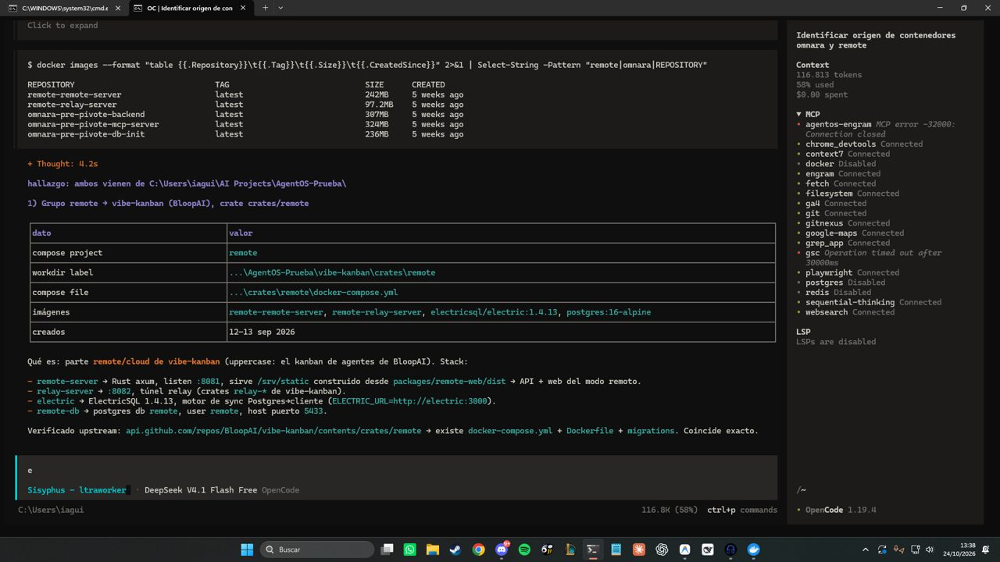
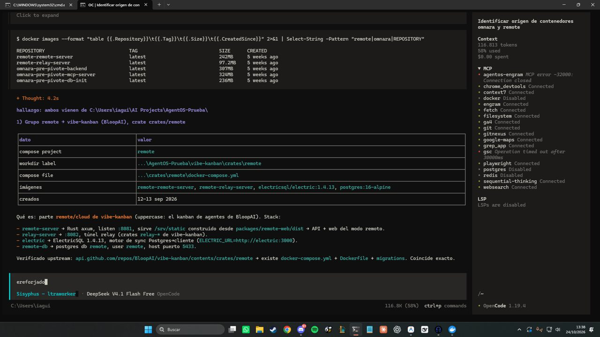
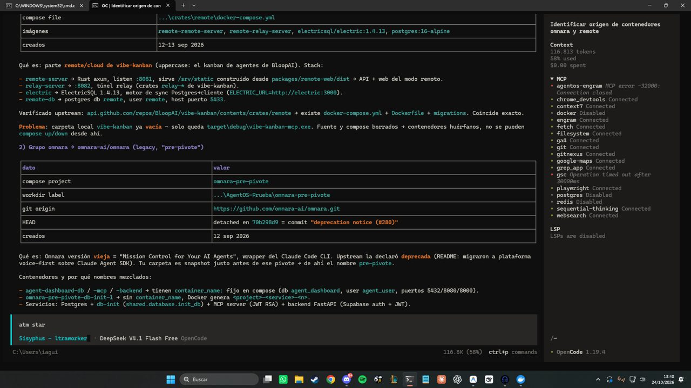

# All The Mods 10: To The Sky — Spanish (es_es) Localization & QA Audit

This repository contains the complete, audited, and in-game verified **Spanish (`es_es`)** translation for **All the Mods 10: To the Sky v2.0.7** (`config/ftbquests/quests/lang/es_es.snbt`), alongside our comprehensive validation reports and in-game visual proofs.

---

## 📊 Localization Metrics & Audit Overview

| Metric | Result | Notes |
|---|---|---|
| **Total Keys in English (`en_us.snbt`)** | 6,462 | Official ATM10-TTS v2.0.7 base |
| **Missing Keys (`missing_vs_en`)** | **0** | 100% key parity |
| **SNBT Parse Errors** | **0** | Strict AST validation |
| **Broken Quoting / Escaping** | **0** | Double quotes safely handled |
| **Color Code & Macro Signatures (`broken_signature`)** | **0** | Exact formatting, line breaks (`\n`), pagebreaks (`{@pagebreak}`), and image macros |
| **Residual English Prose** | **0** | Zero unlocalized sentences or untranslated paragraphs |
| **Rebuilt Quests from Source** | **189** | Fixed legacy meta-instructions and machine paraphrases |
| **Preserved Skyblock Custom Guides** | **137** | Kept custom early-game tips added by Spanish contributors |
| **Approved Quest Batches** | **83 / 83** | 100% formal sign-off across all 9 progression blocks |
| **SHA-256 Hash (`es_es.snbt`)** | `276dc8389226097fc726d77a5d9412f339277518ec23417a6eefa48044868209` | Verified |

---

## 🎮 In-Game QA Visual Verification

Tested inside a live Minecraft client with **all 349 mods** loaded (NeoForge 21.1.250):
- **0 errors or warnings** logged by FTB Quests.
- Verified quest searches, chapter navigation, popup descriptions, color codes, and pagination.

  
  

  
  

---

## 🤝 Open Proposal for the AllTheMods Team: Automated Multi-Language Localization Pipeline

Hi ATM Team! 👋

We developed an **automated AI-driven localization & QA pipeline** specifically tailored for complex Minecraft modpacks. It guarantees:
1. **Zero Game-Breaking Bugs:** Strict SNBT AST validation prevents any syntax or quoting crashes.
2. **Formatting Preservation:** Color codes, inline images, pagebreaks, and formatting macros are mathematically verified against the English source.
3. **Official Mod Terminology:** Item and block names are extracted directly from official mod JARs (`es_es.json`) or retained as in-game JEI terms when a mod lacks native localization.
4. **Automated In-Game Visual QA:** Full client startup and automated UI screenshot capture ensures text fits cleanly in quest cards and popups without clipping.

### Would you be interested in collaborating?
We would love to provide **complete, high-quality Spanish localizations (or localizations into other languages)** for your entire suite of modpacks:
- **All The Mods 10** / **ATM10 Lite** / **ATM10 Aeronautics**
- **All The Mods 9** / **ATM9 - To The Sky** / **ATM9 No Frills**
- **All The Mods 11**
- **All The Magic - Arcana** / **All The Mons**

We can deliver PRs formatted either as single `.snbt` files or split across the `config/ftbquests/quests/lang/<lang>/` directory structure.

### How to reach out:
- **GitHub:** Mention or open a discussion with [@iagorobo24-hub](https://github.com/iagorobo24-hub)
- **Discord:** `iagorobo24` (or reach out on the official All The Mods Discord)

---

## 📁 Repository Files
- `es_es.snbt`: The ready-to-use Spanish translation file (Candidate 191).
- `AUDIT_REPORT.md`: Comprehensive audit methodology, block breakdown, and terminology choices.
- `LOTES_ESTADO_191.json` & `.csv`: Detailed sign-off status of all 83 quest batches.
- `screenshots/`: In-game visual proof from live testing.
