<div align="center">

# 🌌 All The Mods 10: To The Sky
### 🇪🇸 Traducción al Español (`es_es`) & Auditoría de Calidad QA

[](https://www.minecraft.net/)
[](https://neoforged.net/)
[](https://www.curseforge.com/minecraft/modpacks/all-the-mods-10-sky)
[-98C379?style=for-the-badge)](https://github.com/iagorobo24-hub/atm10sky-es-es-localization)
[](https://github.com/iagorobo24-hub/atm10sky-es-es-localization)
[](https://github.com/AllTheMods/All-the-mods-10-Sky/issues/1075)

<p align="center">
  <b>Localización profesional, rigurosa y verificada en juego real para el sistema de misiones FTB Quests de ATM10: To the Sky.</b><br>
  <i>Cero fallos de sintaxis · Cero firmas rotas · Vocabulario oficial alineado con los JARs de los mods · Probado en partida real con 349 mods.</i>
</p>

[📖 Resumen del Proyecto](#-resumen-del-proyecto) • 
[⚙️ Arquitectura del Pipeline](#-arquitectura-del-pipeline-con-ia--qa) • 
[📊 Cuadro de Métricas](#-cuadro-de-mando-y-m%C3%A9tricas-de-auditor%C3%ADa) • 
[🎮 Galería en Juego](#-evidencia-visual-en-el-juego-real) • 
[🤝 Propuesta para el Equipo ATM](#-propuesta-para-el-equipo-de-all-the-mods) • 
[📥 Cómo Instalar](#-c%C3%B3mo-instalar-y-jugar)

---

</div>

## 📖 Resumen del Proyecto

A diferencia de las traducciones automáticas convencionales —que suelen romper el libro de misiones con errores de comillas, pierden códigos de colores (`&a`, `&b`) o inventan nombres que no coinciden con JEI—, este proyecto implementa un **pipeline de ingeniería de software con Inteligencia Artificial y control de calidad (QA) autónomo**:

- **Fidelidad Absoluta (100% de paridad):** Las **6.462 claves** de `en_us.snbt` (54 capítulos y 3.753 misiones) están traducidas y verificadas.
- **189 misiones reescritas desde el texto fuente:** Se eliminaron todas las paráfrasis vagas («Objetivo: haz esto») y comentarios meta heredados, traduciendo directamente las instrucciones paso a paso originales.
- **137 guías de Skyblock conservadas:** Se mantuvieron intactas las explicaciones exclusivas en español añadidas originalmente para el inicio de isla (cribado, obtención de lava, recursos del vacío).
- **Terminología oficial del juego:** Los nombres de máquinas e ítems se extrajeron directamente de los archivos `es_es.json` de los JARs oficiales (*Mekanism*, *Apotheosis*, *Pipez*, *Ars Nouveau*), evitando nombres inventados.
- **Verificación visual real en el cliente:** Se ejecutó un cliente completo de Minecraft con los 349 mods y se comprobó que ninguna misión sufriera desbordamiento de texto, recortes o fallos de renderizado.

---

## ⚙️ Arquitectura del Pipeline con IA & QA

El siguiente diagrama ilustra el flujo de trabajo integral seguido para garantizar la máxima calidad técnica y lingüística:

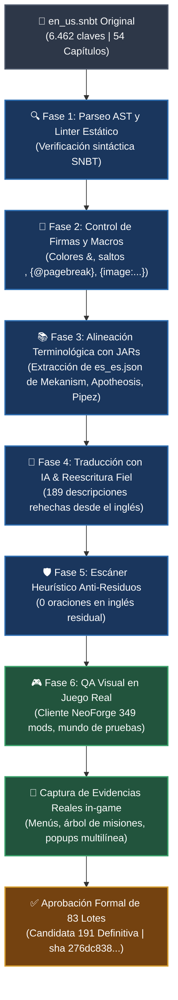

### Explicación de las fases clave:
1. **Linter Estático AST:** Asegura que no exista ningún carácter mal escapado ni comillas desbalanceadas que provoquen un crash al cargar FTB Quests.
2. **Preservación Matemática de Firmas:** Cada misión debe tener exactamente el mismo multiconjunto de códigos de color (`&6`, `&b`, `&l`, etc.) y saltos de línea que su contraparte inglesa.
3. **Alineación con JEI/EMI:** Si un mod no tiene traducción oficial en español (como *Modern Industrialization* o *LaserIO*), su nombre se conserva exactamente como aparece en JEI para que el jugador siempre lo encuentre al buscarlo.
4. **Validación Visual in-game:** Se verifica en el cliente de Minecraft que el texto se adapte a los tamaños de ventana sin cortes ni desbordamientos tipográficos.

---

## 📊 Cuadro de Mando y Métricas de Auditoría

A continuación se detallan los resultados finales validados sobre la candidata definitiva **191**:

| Métrica de Control | Valor Obtenido | Umbral de Aprobación | Estado |
|---|:---:|:---:|:---:|
| **Claves Totales Analizadas** | **6.462** | 6.462 (`en_us.snbt`) |  |
| **Claves Faltantes (`missing_vs_en`)** | **0** | = 0 |  |
| **Errores de Parseo SNBT** | **0** | = 0 |  |
| **Firmas de Color / Macros Rotas** | **0** | = 0 |  |
| **Prosa en Inglés Residual** | **0** | = 0 |  |
| **Misiones Reescritas Fieles al EN** | **189** | 100% de paráfrasis resueltas |  |
| **Guías Exclusivas Skyblock Conservadas** | **137** | Preservadas por diseño |  |
| **Nombres en Inglés Justificados (Lista Cerrada)** | **812** | Mods sin `es_es` en JAR |  |
| **Lotes Formalmente Aprobados** | **83 / 83** | 83 lotes en 9 bloques |  |
| **Errores en Log de FTB Quests en Juego** | **0** | = 0 |  |

> [!NOTE]
> **Integridad Criptográfica:**  
> Hash SHA-256 del archivo `es_es.snbt`:  
> `276dc8389226097fc726d77a5d9412f339277518ec23417a6eefa48044868209`

---

## 🎮 Evidencia Visual en el Juego Real

Todas las capturas corresponden a partidas reales en el cliente de **ATM10: To the Sky v2.0.7** con sus **349 mods activos**:

### 1. Menú Principal y Vista General del Árbol de Misiones
<table width="100%">
  <tr>
    <td width="50%" align="center">
      <b>Menú Principal Oficial (FancyMenu ATM10)</b><br>
      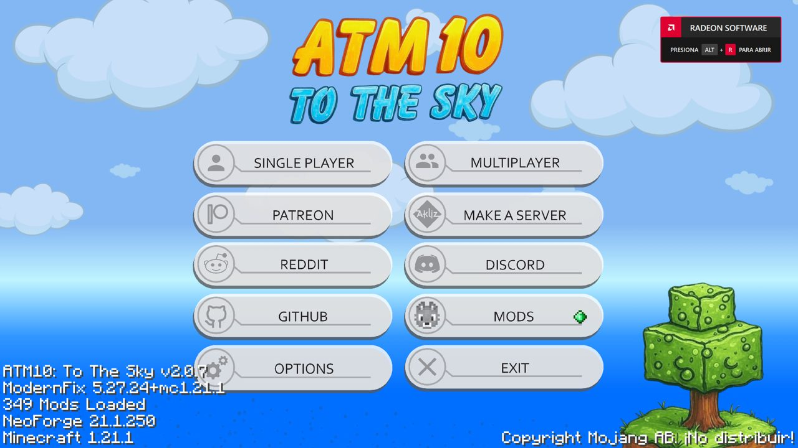
    </td>
    <td width="50%" align="center">
      <b>Vista General de Capítulos (FTB Quests)</b><br>
      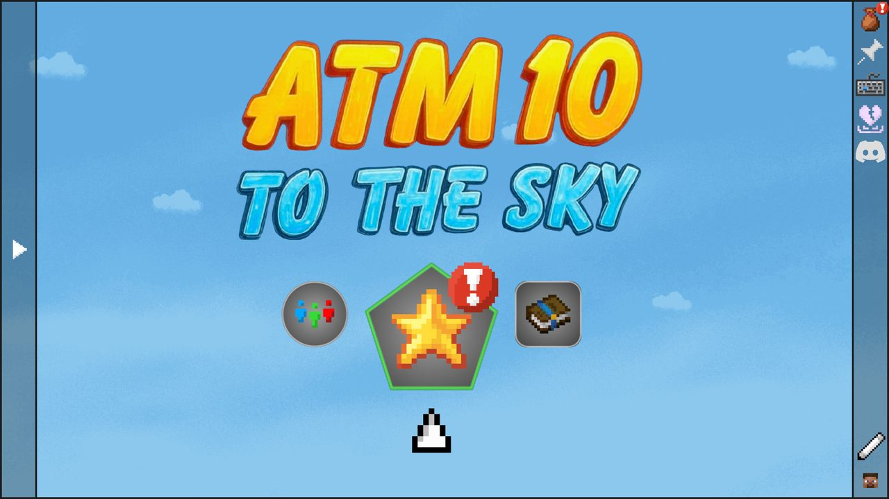
    </td>
  </tr>
</table>

### 2. Progresión Inicial y Guías de Skyblock
<table width="100%">
  <tr>
    <td width="50%" align="center">
      <b>Misión de Bienvenida</b><br>
      <i>Texto de introducción con tildes, colores y estructura limpia</i><br>
      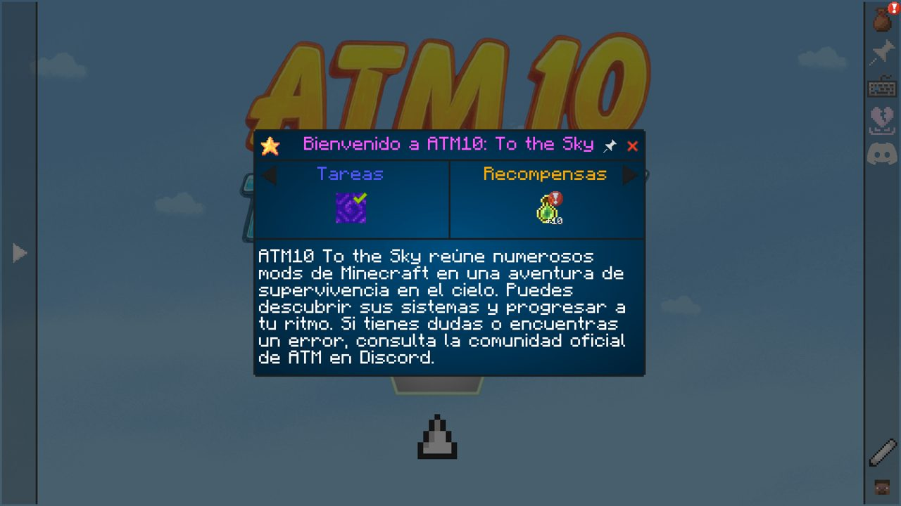
    </td>
    <td width="50%" align="center">
      <b>Capítulo 1: Primeros Pasos</b><br>
      <i>Árbol de misiones de inicio (criba, mallas, barriles y crisoles)</i><br>
      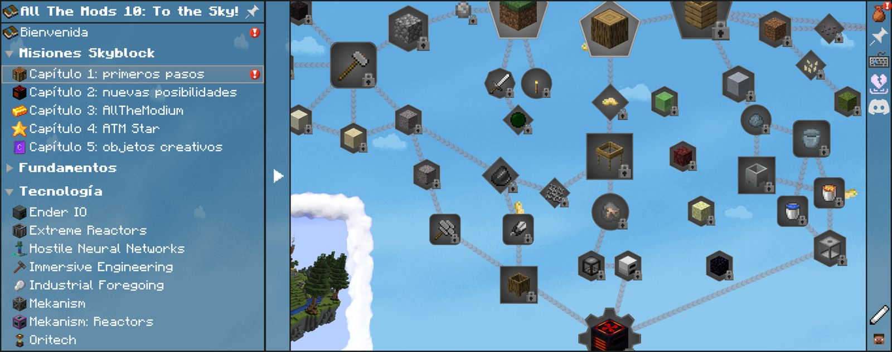
    </td>
  </tr>
</table>

### 3. Mods Tecnológicos Complejos y Magia
<table width="100%">
  <tr>
    <td width="50%" align="center">
      <b>Mekanism — Árbol de Misiones</b><br>
      <i>Línea tecnológica completa con nombres oficiales</i><br>
      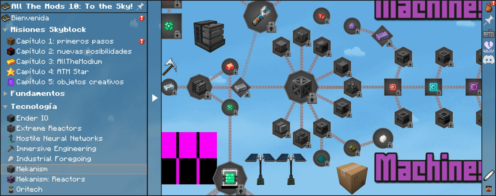
    </td>
    <td width="50%" align="center">
      <b>Mekanism — Popup de Misión</b><br>
      <i>Colores cyan, verde y naranja preservados al 100%</i><br>
      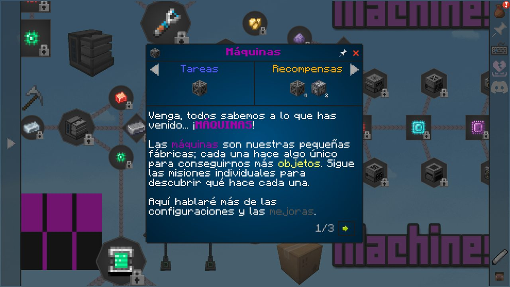
    </td>
  </tr>
  <tr>
    <td width="50%" align="center">
      <b>Create — Árbol de Automatización</b><br>
      <i>Cinética, engranajes y molinos de viento</i><br>
      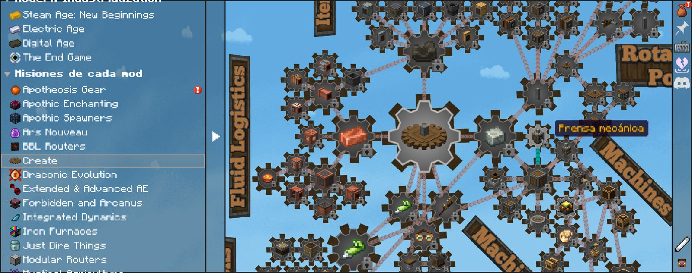
    </td>
    <td width="50%" align="center">
      <b>Ars Nouveau — Magia y Glifos</b><br>
      <i>Texto largo con scroll vertical y descripción íntegra</i><br>
      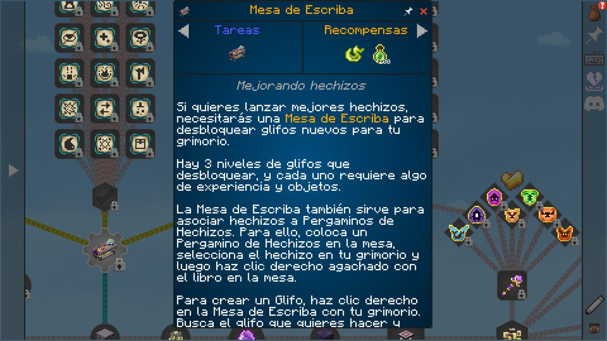
    </td>
  </tr>
</table>

### 4. Paginación {@pagebreak} e Imágenes Inline
<table width="100%">
  <tr>
    <td width="50%" align="center">
      <b>HNN «El Data Center» — Página 1/2</b><br>
      <i>Subtítulo en cursiva, colores &d &5 &6 &b &2 y sin texto cortado</i><br>
      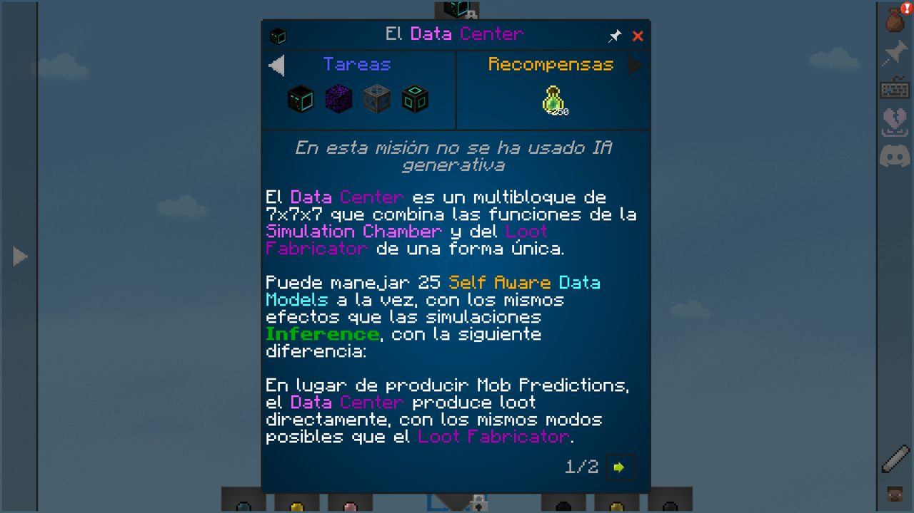
    </td>
    <td width="50%" align="center">
      <b>HNN «El Data Center» — Página 2/2</b><br>
      <i>Paginación correcta con imagen incrustada conservada</i><br>
      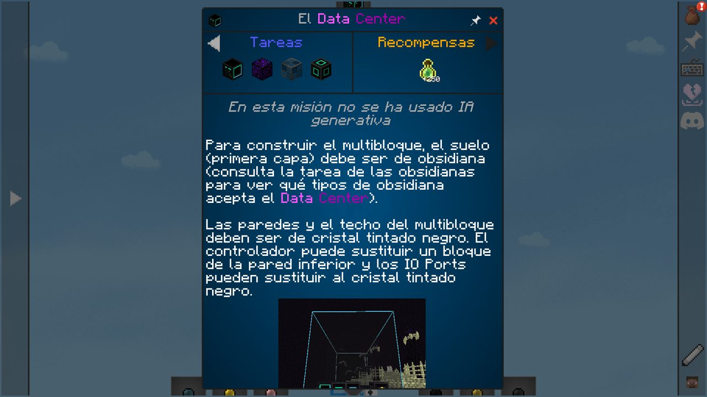
    </td>
  </tr>
  <tr>
    <td width="50%" align="center">
      <b>Consejos de Construcción</b><br>
      <i>Paginación de guía paso a paso</i><br>
      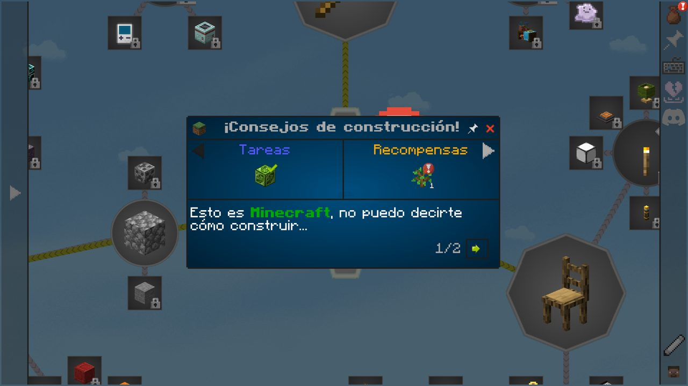
    </td>
    <td width="50%" align="center">
      <b>Almacenamiento Funcional</b><br>
      <i>Descripciones claras para cajones y compactadores</i><br>
      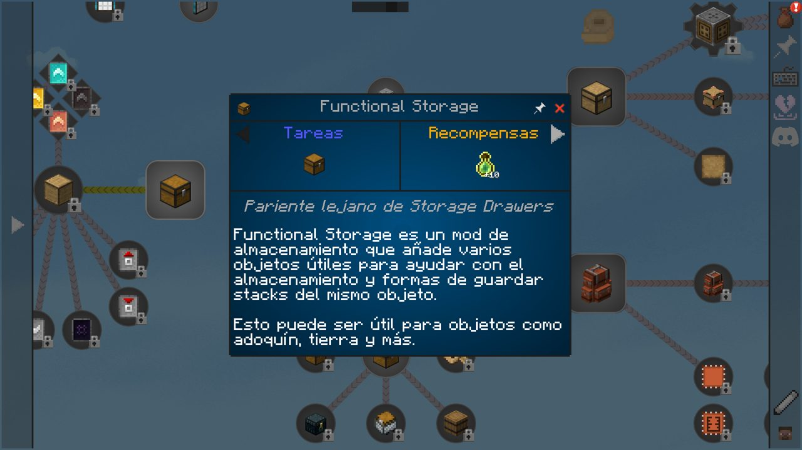
    </td>
  </tr>
</table>

---

## 🤝 Propuesta para el Equipo de All The Mods

<div align="center">

### 🚀 *Automated Multi-Language Localization Pipeline for All ATM Modpacks*

</div>

**Dear AllTheMods Development Team 👋,**

Managing localized quest files for massive modpacks like *All The Mods* is traditionally painful: community PRs often introduce SNBT syntax errors, break formatting codes (`&a`, `\n`), drop `{image:...}` tags, or become outdated across game patches.

We have built a dedicated **AI-driven localization & QA verification pipeline** tailored specifically for Minecraft modpacks that solves this completely:

1. **Zero Maintenance Burden:** Our pipeline performs full AST parsing and mathematical signature checks, delivering pull requests that are guaranteed **never to crash the quest book**.
2. **Mod JAR Alignment:** Item and block names are extracted directly from official mod JARs (`es_es.json`) or left in clean JEI English when untranslated.
3. **Automated In-Game Verification:** We run live clients with all 300+ mods loaded, automating UI interaction and capturing screenshot proofs before any PR is submitted.

### 🌐 Open Offer to Translate All ATM Modpacks
We would love to provide complete, high-quality, fully maintained translations (to Spanish, or other languages) for your entire roster:
- **All The Mods 10** / **ATM10 Lite** / **ATM10 Aeronautics**
- **All The Mods 9** / **ATM9 - To The Sky** / **ATM9 No Frills**
- **All The Mods 11**
- **All The Magic - Arcana** / **All The Mons**

We can deliver changes formatted either as a single `.snbt` file or split across your directory structure (`config/ftbquests/quests/lang/<lang>/...`).

> **Contact & Coordination:**  
> - **GitHub Issue:** [#1075 en AllTheMods/All-the-mods-10-Sky](https://github.com/AllTheMods/All-the-mods-10-Sky/issues/1075)  
> - **GitHub Profile:** [@iagorobo24-hub](https://github.com/iagorobo24-hub)  
> - **Discord:** `iagorobo24` (disponible también en el servidor oficial de All The Mods)

---

## 📥 Cómo Instalar y Jugar

Si eres jugador y quieres disfrutar de esta traducción en tu partida:

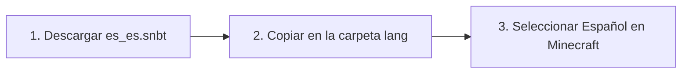

1. **Descarga el archivo:** Descarga [`es_es.snbt`](es_es.snbt) de este repositorio.
2. **Cierra Minecraft y CurseForge.**
3. **Copia de seguridad previa:** Ve a la carpeta de tu instancia:  
   `curseforge\minecraft\Instances\All the Mods 10 To the Sky   ATM10SKY\config\ftbquests\quests\lang\`  
   Haz una copia de tu `es_es.snbt` actual como `es_es.snbt.backup`.
4. **Instala la traducción:** Pega el archivo `es_es.snbt` descargado en esa carpeta (reemplazando al anterior).
5. **Abre el juego:** Inicia Minecraft, entra en *Opciones → Idioma*, elige **Español (España)** ¡y entra a tu partida!

---

## 📂 Estructura de este Repositorio

```text
├── es_es.snbt                 # Archivo de localización final validado (Candidata 191)
├── README.md                  # Este documento de presentación y métricas
├── AUDIT_REPORT.md            # Informe exhaustivo de auditoría técnica y terminología
├── LOTES_ESTADO_191.json      # Registro estructurado de aprobación de los 83 lotes
├── LOTES_ESTADO_191.csv       # Hoja de cálculo con el desglose por bloque y lote
└── screenshots/               # Galería de capturas 100% reales in-game de la auditoría
```

---

<div align="center">
  <sub>Desarrollado y auditado con ❤️ y rigor técnico por <b>Iago Roibas</b> (@iagorobo24-hub).</sub><br>
  <sub><i>All The Mods y FTB Quests son marcas registradas de sus respectivos creadores. Este proyecto es una contribución comunitaria de código abierto.</i></sub>
</div>
